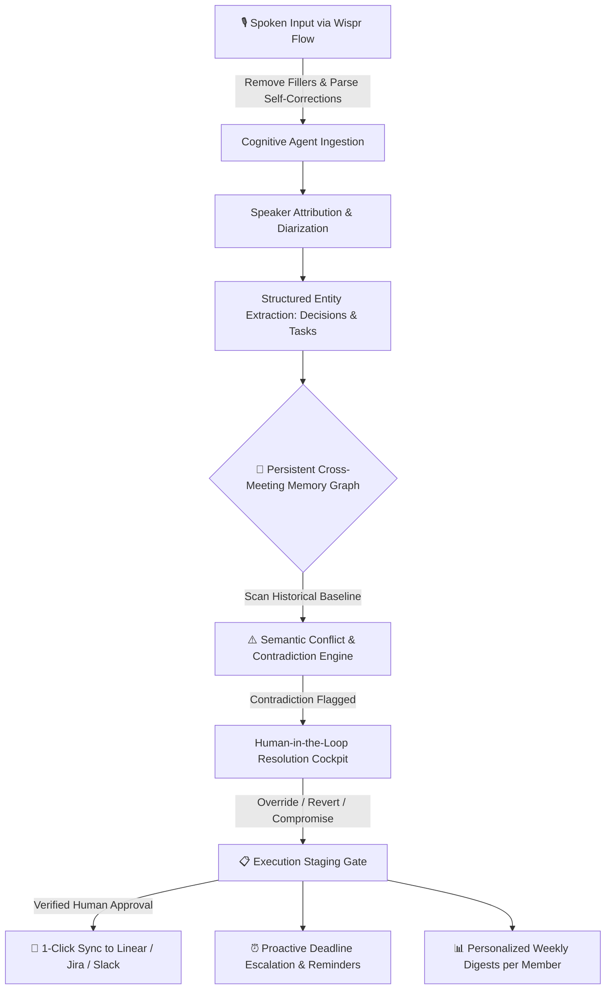

# ⚡ SyncPulse AI
> **Autonomous Meeting-to-Execution Agent with Cross-Meeting Memory & Conflict Intelligence**  
> *Built for the Product Space Agentic AI Hackathon in collaboration with Wispr Flow.*

[](https://theproductspace.in/ai-hackathon-details/problem-statement)
[-violet.svg)](https://ref.wisprflow.ai/productspace)
[](#hackathon-scoring-breakdown)

---

## 🏆 Problem Statement 03: The Challenge

> *"Decisions made in meetings get lost... The cross-meeting memory and the conflict detection are what make this a real system rather than a transcript summarizer."*

Most AI meeting assistants are superficial transcript summarizers. They dump 30 bullet points into Slack that no one reads, and completely fail when a decision in today's sprint contradicts an architectural commitment made two weeks ago.

**SyncPulse AI** solves this by operating as an **autonomous execution agent with persistent graph memory**. It listens, links decisions across sprints, proactively detects contradictions, enforces human approval before posting to trackers (Linear/Jira/Slack), and delivers personalized weekly digests.

---

## ✨ Key Capabilities & Hackathon Rubric Alignment



### 1. 🎙️ Wispr Flow Voice Integration (20% of Total Score)
- **Natural Speech Cleaning**: Converts conversational spoken audio with filler words (`"um"`, `"like"`, `"you know"`, `"basically"`) and speech disfluencies into structured, high-context executive notes.
- **Self-Correction Resolver**: Detects mid-sentence retractions (`"actually wait no, strike that, make it 6 clients"`) and outputs the intended final decision.
- **Live Voice Waveform Console**: Interactive voice dictation studio with visual audio bars and live speech traces.

### 2. 🧠 Persistent Cross-Meeting Knowledge Graph (AI Integration 20%)
- Instead of treating meetings as isolated silos, SyncPulse maintains an interconnected graph of architectural commitments across **Sprint 14, Sprint 15, and Sprint 16**.
- Tracks decision status: `active`, `superseded`, `disputed`, or `deprecated`.

### 3. 🛡️ Semantic Conflict & Contradiction Engine (Problem Understanding 15%)
- Automatically flags when current proposals break historical commitments:
  - **Critical Tech Stack Contradiction**: Flags attempt to migrate to MongoDB Atlas on GCP after Sprint 14 locked AWS RDS PostgreSQL.
  - **SLA Timeline Slip**: Flags a 13-day release delay against the contractually locked Nov 15 public GA deadline.
  - **Orphaned Ownership Drift**: Highlights unassigned / ambiguous DRI handovers (e.g., SOC2 compliance).
- **Human-in-the-Loop Resolver**: Choose between **Override Past Baseline**, **Revert & Enforce Baseline**, or **Synthesize Compromise**.

### 4. 📋 Execution Staging & Approval Gate (Prototype UX 20%)
- **Zero Bot Spam**: A mandatory staging cockpit prevents automated junk from entering production task trackers.
- Review assignees, deadlines, and priorities (P0, P1, P2).
- One-click confirmation dispatches verified issues to **Linear, Jira, Slack, and GitHub**.

### 5. 📊 Personalized Weekly Digests per Person
- Tailored digests for **Priya** (Lead PM), **Vikram** (Architect), **Sarah** (Designer), **Rohit** (Full-Stack), and **Ananya** (AI Lead).
- Each person sees *only* their commitments, their deadlines, and decisions directly impacting their domain.
- 1-Click "Copy Slack Broadcast Markdown" and Wispr audio playback.

### 6. ⏰ Proactive Deadline Escalations
- Pre-deadline notification engine with automated escalation logic (**T-48h gentle check-in**, **T-24h warning**, **overdue escalation**).

### 7. 🚀 LinkedIn Streak & +10 Bonus Point Hub
- Pre-loaded viral LinkedIn post templates tailored to the Product Space submission guidelines for maximum engagement and full bonus points.

---

## 🛠️ Tech Stack

- **Frontend**: React 19 + TypeScript + Vite
- **Styling**: Tailwind CSS v4 (Glassmorphic dark design system)
- **Icons**: Lucide React
- **Celebration Effects**: Canvas Confetti
- **Agent Architecture**: Stateful semantic cognitive engine with cross-meeting graph memory & Wispr Flow speech cleaning pipeline

---

## 🚀 Quickstart & Installation

```bash
# Clone the repository
git clone https://github.com/<your-username>/syncpulse.git
cd syncpulse

# Install dependencies
npm install

# Start development server
npm run dev
```

Visit `http://localhost:5173` to explore the live app!

---

## 🧪 Demo Scenario Walkthrough for Hackathon Judges

1. **Ingestion & Voice Tab**: Review Sprint 16's transcript or open **Wispr Voice Input** to dictate a new debrief note.
2. Click **Run Cognitive Agent**: SyncPulse processes the conversation in real-time.
3. **Conflict Center**: View the 3 flagged contradictions against Sprint 14 baseline. Test the **Synthesize Compromise** resolution action.
4. **Memory Graph**: Explore the connected node graph across Sprints 14, 15, and 16.
5. **Execution Staging**: Review staged tasks and click **Confirm & Sync to Trackers** (enjoy the celebration confetti!).
6. **Weekly Digests**: Switch between Priya, Vikram, Sarah, Rohit, and Ananya to see personalized executive digests.

---

## 📄 License

MIT License. Built with ❤️ for the Product Space Agentic AI Hackathon.
