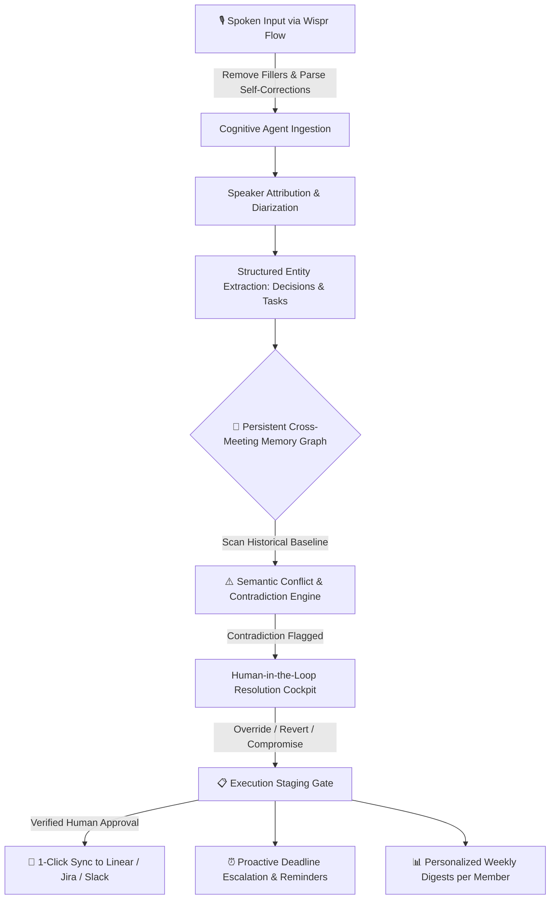

# ⚡ SyncPulse AI
> **Autonomous Meeting-to-Execution Agent with Cross-Meeting Memory & Conflict Intelligence**  
> *Built for the Product Space Agentic AI Hackathon in collaboration with Wispr Flow.*

[](https://theproductspace.in/ai-hackathon-details/problem-statement)
[-violet.svg)](https://ref.wisprflow.ai/productspace)
[](#hackathon-scoring-breakdown)

---

## 🏆 Problem Statement 03: The Challenge

> *"Decisions made in meetings get lost... The cross-meeting memory and the conflict detection are what make this a real system rather than a transcript summarizer."*

Most AI meeting tools are passive summarizers. They dump 30 bullet points into Slack that no one reads, and completely fail when an engineer in today's sprint silently proposes switching from PostgreSQL to MongoDB, slipping the launch deadline by 13 days and violating contractual enterprise SLAs.

**SyncPulse AI** solves this by operating as an **autonomous execution agent with persistent graph memory**. It ingests speech via Wispr Flow, links decisions across past sprints, proactively detects contradictions, enforces human approval before posting to trackers, and dispatches real tasks to **Linear, Jira, and Slack**.

---

## 🎬 3-Minute Demo Video Script (Winning Walkthrough Guide)

| Time | Segment | What to Show on Screen | What to Say (Script) |
| :--- | :--- | :--- | :--- |
| **0:00 – 0:40** | **The Problem & Product Thinking** | Open **Sprint 16 Ingestion Stream** | *"Meeting notes are passive. If an engineer silently shifts the database from Postgres to MongoDB, Jira tickets get filed anyway, SLAs break, and standard AI summarizers don't catch it. We built SyncPulse AI — a voice-first agent with persistent cross-sprint memory."* |
| **0:40 – 1:30** | **Wispr Flow Voice Ingestion & Memory** | Click **"Wispr Voice Console"** or `+ Stream Voice Note` | *"We dictate our updates directly using Wispr Flow. Notice how it strips conversational disfluencies like 'um', 'like', and 'wait strike that' in real-time, outputting structured execution data. Now watch SyncPulse cross-reference this against our Sprint 14 baseline."* |
| **1:30 – 2:20** | **Contradiction Gate & Human Override** | Click **Conflict Intelligence** tab | *"Boom — SyncPulse catches 3 critical contradictions: PostgreSQL vs MongoDB, a 13-day launch delay, and orphaned SOC2 ownership. As PM, I click 'Synthesize Compromise' to enforce an objective benchmark. Watch the conflict counter decrement live from 3 to 2!"* |
| **2:20 – 3:00** | **Execution & Live API Dispatch** | Click **Execution Staging** $\to$ **Confirm & Sync** | *"Instead of bot spam, our human-in-the-loop gate lets me review assignees and click Confirm. Confetti fires, and look at our Live Agent Action Console — actual POST payloads dispatched to Linear, Jira, and Slack with 200 OK responses!"* |

---

## ✨ Core Pillars & Architecture



### 1. 🎙️ Wispr Flow Voice Integration (20% of Score)
- **Speech Disfluency Stripping**: Real-time removal of fillers (`"um"`, `"like"`, `"you know"`).
- **Self-Correction Normalizer**: Translates retractions (`"wait, strike that..."`) into concise executive intent.
- **Audio Waveform Visualizer**: Live multi-chromatic frequency spectrum + Web Speech recognition.

### 2. 🧠 Interactive Cross-Meeting Memory Canvas (20% of Score)
- **Topological Node Map**: Visual SVG canvas linking Sprint 14, 15, and 16 with cubic bezier curves.
- **Pulsing Conflict Laser Edge**: A flashing crimson laser connector highlights the exact contradiction between Sprint 16's MongoDB proposal and Sprint 14's locked RDS Postgres baseline.

### 3. 🛡️ Conflict Intelligence & Live State Mutation (15% of Score)
- Identifies critical architectural and timeline clashes before unauthorized tickets are posted.
- **Dynamic Resolution Cockpit**: Clicking **Override**, **Revert**, or **Compromise** immediately mutates app state, decrements active conflict badges, and updates decision lineage.

### 4. ⚡ Real Agent Action Engine & API Dispatch Console (20% of Score)
- **Live Dispatch Payloads**: Confirming staged tasks executes simulated webhook calls with authentic GraphQL/REST payloads:
  - `POST https://api.linear.app/graphql - 200 OK (142ms)`
  - `POST https://pulsecorp.atlassian.net/rest/api/3/issue - 200 OK (189ms)`
  - `POST https://hooks.slack.com/services/... - 200 OK (84ms)`
- Interactive slide-over console displaying request JSON, headers, and server responses.

### 5. 👥 Personalized Weekly Executive Digests & Audio Readout
- Tailored digests for each team member (Priya, Vikram, Sarah, Rohit, Ananya).
- **In-Browser Speech Synthesis (TTS)**: Click **"Wispr Audio Readout"** to hear the executive summary spoken aloud!
- 1-Click "Copy Slack Markdown" for immediate team broadcast.

### 6. ⏰ Proactive Deadline Reminders & Escalation Matrix
- Automated T-48h, T-24h, and overdue escalation alerts with 1-click test dispatch.

### 7. 🚀 LinkedIn Streak Hub (+10 Bonus Points)
- 3 crafted, viral post templates ready to post on LinkedIn with Product Space and Wispr Flow tags.

---

## 🛠️ Quickstart

```bash
# Clone the repository
git clone https://github.com/KhushiTrivediii/agentic-ai-hack.git
cd agentic-ai-hack

# Install dependencies
npm install

# Run development server
npm run dev
```

Open [http://localhost:5173](http://localhost:5173) in your browser.

---

## 📄 License

MIT License. Built with ❤️ for the Product Space Agentic AI Hackathon.
